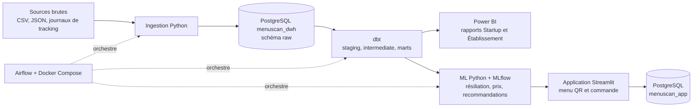

# MenuScan TN – Projet data et BI de bout en bout

Projet de portfolio réalisé par **Sarra Abdeljaouad** : une chaîne data complète, de la donnée brute aux tableaux de bord et au machine learning, pour une startup tunisienne fictive qui vend un **menu numérique à QR code** avec **commande depuis la table** aux cafés et restaurants.

> Données fictives : MenuScan TN est une entreprise simulée. Toutes les données viennent d'un générateur Python décrit dans ce dépôt.

## Le problème métier

MenuScan TN vend un abonnement (15, 35 ou 60 DT HT par mois) à 403 établissements signés entre 2024 et 2026. Fin 2026, son revenu récurrent mensuel atteint 8 510 DT HT, mais :

- **3,1 %** des établissements résilient chaque mois, souvent parce que le QR code est peu utilisé ;
- le coût d'acquisition d'un client varie de **17 DT** (parrainage) à **110 DT** (salons) ;
- les données d'usage, de facturation et de marketing sont dispersées dans 124 fichiers, avec plus de 30 000 anomalies.

Le projet construit un système de pilotage fiable : suivre le revenu, détecter les établissements sur le point de partir et orienter les dépenses vers les canaux les plus rentables.

## Architecture



## Pile technique

| Couche | Outils |
|---|---|
| Application | Streamlit, Python (qrcode) |
| Bases de données | PostgreSQL dans Docker |
| Données | Générateur Python (pandas, NumPy) |
| Transformations et qualité | dbt Core (modèles, tests, snapshots, documentation) |
| Orchestration | Airflow, Docker Compose |
| Tableaux de bord | Power BI Desktop (sécurité par ligne) |
| Analyse et ML | Python, scikit-learn, statsmodels, MLflow |

## Avancement

| Phase | Contenu | Statut |
|---|---|---|
| 0. Cadrage | Dossier de cadrage, pilotage, analyse des sources, gouvernance des données, recette | Terminée (validée sans réserve le 24/11/2026) |
| 1. Environnement et application | Docker, base applicative, applications client et équipe, QR codes ; extensions (lots 0 à 3 : service en salle, gestion du menu et des tables, avis, clôture de la journée) | Terminée (validée le 24/11/2026 ; extensions validées le 25/11/2026) |
| 2. Données | Reproductibilité du générateur, jeu public v1.1, jeu de démonstration | Terminée (25/11/2026) |
| 3. Ingestion | Chargement des 124 fichiers bruts | À venir |
| 4. Entrepôt dbt | Nettoyage, sessions, modèle en étoile, tests | À venir |
| 5. Orchestration | DAG Airflow | À venir |
| 6. Tableaux de bord | Rapports Startup et Établissement | À venir |
| 7. Analyse et ML | Résiliation, sensibilité au prix, recommandations | À venir |
| 8. Retour dans l'application | Scores et recommandations affichés | À venir |
| 9. Recette et mise en valeur | PV final, démonstration en ligne | À venir |

## Données

- **Dans ce dépôt (phase 2) :** le jeu de démonstration (20 établissements sur 6 mois, au format Parquet) dans `03_generateur/demo_data/`, et le script qui l'extrait. Le code du générateur sera publié en phase 9 (décision D-30).
- **Jeu complet :** 403 établissements, 296 166 sessions, 1,6 million d'événements, 106 682 commandes, de 2024 à 2026. Il est disponible en téléchargement dans la page Releases du dépôt (fichier ZIP).
- Le générateur recrée le jeu complet à l'identique (relance vérifiée le 25/11/2026, note MS-DATA-NV2-001) ; son code sera publié en phase 9.

## Démarrage rapide

```bash
git clone https://github.com/sarraabdeljaouad-ui/menuscan-tn.git
cd menuscan-tn
python -m venv .venv
.venv\Scripts\activate          # Windows (macOS ou Linux : source .venv/bin/activate)
pip install -r requirements.txt
docker compose up -d            # démarre PostgreSQL
```

Le détail est dans [docs/Installation du poste de travail.md](docs/Installation%20du%20poste%20de%20travail.md).

## Présentation détaillée

L'entreprise, les données, les dix phases et les outils sont expliqués dans [docs/Presentation du projet.md](docs/Presentation%20du%20projet.md).

## Arborescence

Voir [docs/Arborescence du depot.md](docs/Arborescence%20du%20depot.md). Conventions de nommage et de codage : [docs/Conventions de nommage et de codage.md](docs/Conventions%20de%20nommage%20et%20de%20codage.md).

## Autres projets

- **TuniShop** : projet data et BI e-commerce de bout en bout (SQL Server, SSIS, SSAS, Power BI, Tableau, Python) – [dépôt GitHub](https://github.com/sarraabdeljaouad-ui/tunishop-projet-data-bi)

## Auteure

Sarra Abdeljaouad – [LinkedIn](https://www.linkedin.com/in/sarra-abdeljaouad-927282451/)

## Licence

Code sous licence MIT. Données fictives, libres d'usage pour la formation et les portfolios.
