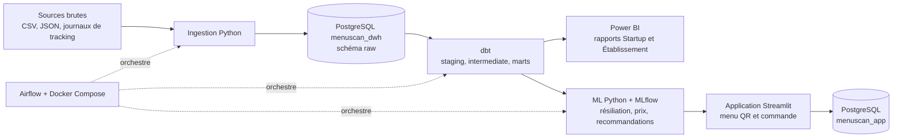

# Présentation du projet MenuScan TN

**Référence :** MS-DATA-PRS-001 · **Version :** 1.0 · **Date :** 24/11/2026 · **Auteure :** Sarra Abdeljaouad

Ce document explique le projet simplement : l'entreprise simulée, les données, l'architecture, les dix phases et les outils.

## 1. Le projet en une phrase

MenuScan TN est un projet de portfolio qui simule une mission data et BI complète : des données brutes et imparfaites jusqu'aux tableaux de bord et au machine learning, pour une startup tunisienne fictive.

## 2. L'entreprise simulée

**Ce qu'elle vend.** Un menu numérique à QR code pour les cafés et restaurants. Le client scanne le QR code de sa table, consulte le menu sur son téléphone et peut commander depuis la table.

**Comment elle gagne de l'argent.** Un abonnement mensuel ou annuel, en trois formules :

| Formule | Prix HT par mois | Ce qu'elle permet |
|---|---|---|
| Essentiel | 15 DT | Menu consultable, sans commande |
| Commande | 35 DT | Menu et commande depuis la table |
| Pro | 60 DT | Commande et tableau de bord pour le gérant |

Des frais de mise en place de 150 DT HT sont facturés une fois, à la signature. L'abonnement annuel coûte 10 mois au lieu de 12.

**Sa situation fin 2026.**

- 403 établissements signés depuis 2024, dans 8 villes ; 265 sont encore actifs.
- Revenu récurrent mensuel (MRR) : 8 510 DT HT.
- 3,1 % des établissements résilient chaque mois, souvent parce que le QR code est peu utilisé.
- 5 canaux d'acquisition : publicité Meta, TikTok, prospection terrain, parrainage, salons. Un client coûte 17,3 DT par parrainage et 110,5 DT par les salons.

**Son problème.** Les données existent mais sont dispersées dans 124 fichiers de formats différents, avec 31 718 anomalies. Il est impossible de répondre de façon fiable à des questions simples : quel est le vrai revenu ? Qui va partir le mois prochain ? Quel canal rapporte le plus ?

**Ce que le projet apporte.** Un système de pilotage fiable pour suivre le revenu, détecter les établissements sur le point de résilier, orienter le budget marketing vers les canaux rentables et aider les gérants à vendre plus.

## 3. Les objectifs chiffrés

| Code | Objectif | Valeur 2026 | Cible |
|---|---|---|---|
| OM1 | Réduire les résiliations | 3,1 % par mois | 2,6 % |
| OM2 | Réduire le coût d'acquisition | 62,6 DT | 56,3 DT |
| OM3 | Développer les montées de gamme | 24 par an | 34 |
| OM4 | Augmenter les commandes en salle | 62,3 % des sessions | 65 % fin 2027 |
| OM5 | Réduire les retards de paiement | 9,9 % des factures | 8,5 % fin 2027 |
| OM6 | Réduire le reporting manuel | environ 4 h par semaine (hypothèse) | moins de 1 h |

Le business case (MS-DATA-BC-001 v1.1) valorise le projet à 80 jours de travail. Dans le scénario central, le ROI sur trois ans est de 6,1 % ; le projet est rentable si le taux de résiliation baisse d'au moins 0,44 point.

## 4. Les données

Le jeu de données est produit par un générateur Python à graine fixe : il est reproductible à l'identique. Il couvre 2024 à 2026.

**Trois couches :**

1. **Couche brute** (`donnees_brutes/`, 124 fichiers) : les données telles qu'elles arriveraient en conditions réelles, avec leurs défauts (doublons, noms en majuscules, dates mal formatées, montants incohérents, horloges décalées). C'est la couche à nettoyer.
2. **Couche de référence** (`donnees_reference/`) : les mêmes données, propres. Elle permet de vérifier que le nettoyage retrouve le bon résultat.
3. **Solutions** (non publiées) : la liste des anomalies injectées et les vérités terrain du machine learning, pour mesurer la qualité du travail.

**Les grands domaines :**

- **Clients** : établissements, villes, tables de salle, prospects.
- **Abonnements** : formules et historique des changements.
- **Usage** : 1,6 million d'événements de navigation, à partir desquels on reconstruit 296 166 sessions.
- **Ventes en salle** : 106 682 commandes, articles, historique des prix.
- **Facturation** : factures, paiements, retards, impayés.
- **Marketing** : campagnes et dépenses quotidiennes par canal.
- **Support** : tickets.

Des scénarios simulés rendent les données réalistes : le Ramadan (activité de 19 h à 1 h, maximum vers 21 h), une panne le 12/09/2025 de 10 h à 16 h, des établissements engagés, tièdes ou décrocheurs.

## 5. L'architecture

Deux bases séparées : `menuscan_app` est la base de l'application, où s'écrivent les commandes ; `menuscan_dwh` est l'entrepôt, où se fait l'analyse. La séparation évite que l'analyse ralentisse l'application.

## 6. Les phases

Le planning compte 20 semaines. La semaine S1 commence le 23/11/2026 ; la phase 1 démarre le 04/01/2027.

| Phase | Semaines | Charge | Statut |
|---|---|---|---|
| 0. Cadrage | S1 à S4 | 10 jours | Terminée, validée sans réserve le 24/11/2026 |
| 1. Environnement et application | S7 à S8 | 10 jours | À venir |
| 2. Données (finalisation) | S9 | 5 jours | À venir |
| 3. Ingestion | S10 | 5 jours | À venir |
| 4. Entrepôt dbt | S11 à S13 | 15 jours | À venir |
| 5. Orchestration | S14 | 5 jours | À venir |
| 6. Tableaux de bord | S15 à S16 | 10 jours | À venir |
| 7. Analyse et ML | S17 à S18 | 10 jours | À venir |
| 8. Retour dans l'application | S19 | 5 jours | À venir |
| 9. Recette et mise en valeur | S20 | 5 jours | À venir |

### Phase 0 : Cadrage

**But :** comprendre le métier et préparer le travail avant d'écrire du code. Les livrables sont dans `00_cadrage/` :

- **Cadrage et besoins métier** : présentation de l'entreprise, note de cadrage, étude de l'existant, besoins métier, cahier des charges, business case.
- **Organisation et pilotage** : plan de management, registre des décisions, actions et risques, classeur de pilotage.
- **Analyse des données sources** : exploration, cartographie des relations, audit qualité indépendant (99,8 % des anomalies retrouvées), plan d'intégration.
- **Gouvernance des données** : référentiel des 19 KPI, catalogue des 38 règles qualité, modèles de données, lignage.
- **Environnement et dépôt** : README, conventions, guide d'installation (placés à la racine et dans `docs/`).
- **Validation** : cahier de recette, rapport de validation, PV de clôture, PV de levée des réserves.

### Phase 1 : Environnement et application

**But :** faire exister le produit.

- Créer et charger les tables de `menuscan_app` dans PostgreSQL.
- Construire l'application Streamlit : choix de la table, menu, panier, commande enregistrée en base.
- Générer un QR code par table.

Cette phase montre d'où viennent les données.

### Phase 2 : Données (finalisation)

**But :** rendre le jeu de données utilisable par tous.

- Relancer le générateur hors du dépôt public et prouver qu'il redonne exactement le même jeu (empreintes SHA-256). Son code sera publié en phase 9 : il contient les réponses que le dossier `solutions/` garde cachées (décisions D-16 et D-30).
- Publier une version du jeu sans `solutions/` ni `generateur/`, avec les empreintes de chaque fichier.
- Créer un jeu de démonstration (20 établissements sur 6 mois, format Parquet) pour tester le projet sans télécharger la Release.

### Phase 3 : Ingestion

**But :** charger les 124 fichiers bruts dans l'entrepôt, sans les modifier.

- Un script Python lit chaque fichier (CSV, JSON, journaux de tracking) et l'écrit dans le schéma `raw` de `menuscan_dwh`.
- Des colonnes techniques sont ajoutées : date de chargement, fichier d'origine.
- Rien n'est corrigé à cette étape : on garde la donnée telle qu'elle est arrivée.

### Phase 4 : Entrepôt dbt

**But :** transformer la donnée brute en donnée fiable et prête pour l'analyse. Trois étages :

1. **staging (`stg_`)** : nettoyage table par table (noms, types, formats, doublons).
2. **intermediate (`int_`)** : logique métier (reconstitution des sessions à partir des événements, périodes d'abonnement, rapprochement des paiements et des factures).
3. **marts (`fait_`, `dim_`)** : modèle en étoile pour Power BI. Les faits contiennent les mesures (commandes, sessions, factures, dépenses) ; les dimensions les décrivent (établissement, date, article, canal, formule).

S'y ajoutent des **tests dbt** (règles qualité automatiques), des **snapshots** pour l'historique des abonnements et des prix (SCD de type 2) et la **documentation dbt** avec le graphe de lignage. Le résultat est comparé à la couche de référence.

### Phase 5 : Orchestration

**But :** faire tourner la chaîne seule, dans le bon ordre.

- Un DAG Airflow enchaîne ingestion, `dbt run`, `dbt test` et le recalcul des modèles.
- Si un test échoue, la chaîne s'arrête et signale l'erreur.

### Phase 6 : Tableaux de bord

**But :** donner les réponses aux décideurs. Deux rapports Power BI :

- **Rapport Startup** (direction, marketing, finance) : MRR, résiliation, cohortes, coût d'acquisition par canal, entonnoir de conversion, retards de paiement.
- **Rapport Établissement** (gérants) : ventes, panier moyen, plats populaires, heures de pointe, effet du Ramadan.

La **sécurité par ligne (RLS)** garantit que chaque gérant ne voit que son établissement.

### Phase 7 : Analyse et ML

Trois modèles :

1. **Prédiction de la résiliation** : identifier un mois à l'avance les établissements qui vont partir (usage et tendance, tickets, retards de paiement, formule, canal). Seuil de qualité : AUC d'au moins 0,75.
2. **Sensibilité au prix** : mesurer l'effet d'un changement de prix sur les ventes d'un plat, en tenant compte du jour, de l'heure, du Ramadan et de la saison.
3. **Recommandations de plats** : trouver les plats commandés ensemble avec des règles d'association (support, confiance, lift).

Chaque modèle est suivi dans MLflow et décrit dans une fiche modèle.

### Phase 8 : Retour dans l'application

**But :** que l'analyse serve au quotidien.

- Le score de risque de résiliation s'affiche pour l'équipe succès client.
- Les recommandations de plats s'affichent côté gérant.

La donnée produite par l'application revient l'améliorer.

### Phase 9 : Recette et mise en valeur

- Recette finale et PV de clôture du projet.
- Démonstration, captures, synthèse d'une page en PDF.
- README final.
- Publication du code du générateur (décision D-30).

## 7. Les outils

Tous les outils sont gratuits ; tout tourne en local.

| Outil | Rôle | Détail |
|---|---|---|
| Git et GitHub | Versionner et publier | Dépôt public ; jeu complet dans la Release `v1.1-donnees` (sans corrigés ni générateur) |
| Python 3 | Langage principal | Générateur, ingestion, application, ML ; environnement virtuel `.venv` |
| pandas, NumPy, PyArrow | Manipuler les données | CSV, JSON, Parquet, calculs |
| Docker Desktop | Faire tourner les services | Conteneurs isolés et reproductibles |
| PostgreSQL 16 | Base de données | Dans Docker, port 5440 du poste ; bases `menuscan_app` et `menuscan_dwh` |
| SQLAlchemy, psycopg2 | Relier Python à PostgreSQL | Ingestion et application |
| DBeaver | Explorer les bases | Requêtes SQL, consultation des tables |
| Streamlit | Application web en Python | Menu QR et commande |
| qrcode | Générer les QR codes | Un QR code par table |
| dbt Core 1.12.7 | Transformer en SQL | Modèles, tests, snapshots, documentation, lignage |
| Airflow | Orchestrer | Enchaînement, planification, alertes |
| Power BI Desktop | Tableaux de bord | Import depuis `menuscan_dwh`, RLS, fichiers `.pbip` |
| scikit-learn | Modèle de résiliation | Classification, validation dans le temps, AUC |
| statsmodels | Sensibilité au prix | Régressions, élasticités |
| mlxtend | Recommandations | Règles d'association |
| MLflow | Suivre les modèles | Paramètres, scores et modèles de chaque essai |
| Jupyter, VS Code | Écrire et explorer | Notebooks et code |
| draw.io | Schémas | Modèles conceptuel et relationnel, flux des sources |

## 8. Compétences mises en œuvre

- **Data engineering** : ingestion, nettoyage, entrepôt, tests, orchestration.
- **BI** : modèle en étoile, KPI définis et tracés, Power BI avec RLS.
- **Data science** : trois modèles utiles au métier, suivis et documentés.
- **Gestion de projet** : cadrage, business case, registres, recette et PV.
- **Produit** : une application qui produit la donnée puis réutilise les résultats de l'analyse.

Par rapport au projet TuniShop, MenuScan TN ajoute l'application, dbt, Airflow, Docker et le retour des modèles dans l'application.
